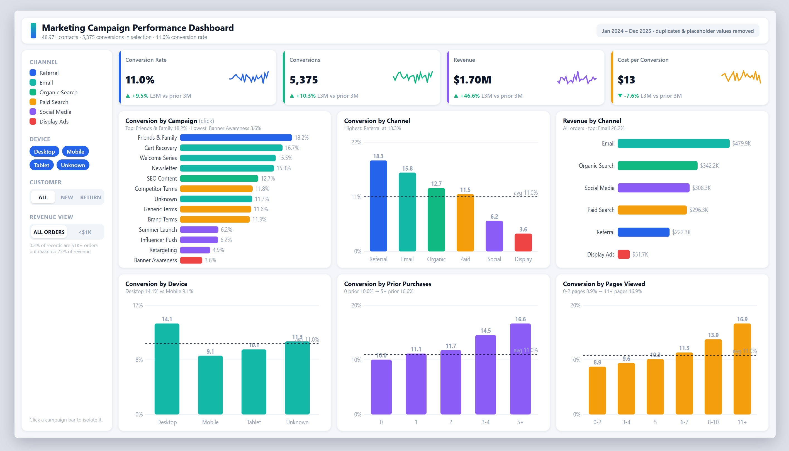

# 📣 Marketing Campaign & Customer Conversion Analysis

An end-to-end **Marketing Campaign & Customer Conversion Analytics** project built using **Python (Pandas), SQL, Excel, and a Web-Based Interactive Dashboard** to analyze marketing campaign performance, customer conversion behavior, channel effectiveness, revenue contribution, and customer engagement patterns.

The project follows a structured data analytics workflow, covering business problem definition, data inspection, data cleaning, data preparation, exploratory data analysis (EDA), SQL business analysis, KPI development, interactive dashboard development, business insights, and actionable recommendations.

---

## 🎯 Project Objective

The objective of this project is to analyze marketing campaign effectiveness, understand customer conversion behavior, evaluate marketing channel performance, and identify opportunities to improve marketing outcomes.

Key objectives:

- Evaluate marketing campaign performance.
- Measure customer response and conversion rates.
- Identify high-performing and underperforming campaigns.
- Compare conversion performance across marketing channels.
- Analyze customer behavior and engagement patterns.
- Understand the relationship between prior purchases and conversion.
- Examine how website engagement relates to customer conversion.
- Evaluate revenue contribution across marketing channels.
- Monitor marketing performance through relevant KPIs.
- Develop an interactive dashboard for business reporting.
- Generate actionable, data-driven marketing recommendations.

---

## 💼 Business Problem

Marketing teams invest resources in different campaigns and channels to attract and convert customers.

However, measuring campaign reach or customer interactions alone does not reveal which marketing activities generate the strongest business outcomes.

Businesses need to understand:

- Which campaigns generate the highest conversion rates?
- Which marketing channels perform most effectively?
- Which customer groups are more likely to convert?
- Does previous purchase history influence conversion?
- How does website engagement relate to conversion?
- Which channels contribute the most revenue?
- Which campaigns demonstrate weaker performance?
- Where can marketing strategies be optimized?

This project uses Python, SQL, and interactive data visualization to transform marketing data into meaningful business insights.

---

## 💡 Business Value

The analysis helps businesses:

- Evaluate campaign effectiveness using measurable KPIs.
- Compare marketing channel conversion performance.
- Understand customer engagement and purchasing patterns.
- Identify customer segments with stronger observed conversion rates.
- Evaluate revenue contribution across marketing channels.
- Identify underperforming campaigns and channels.
- Support customer targeting and campaign optimization.
- Make evidence-based marketing decisions.

---

## ❓ Business Questions

The project focuses on answering the following business questions:

1. Which marketing campaigns generate the highest conversion rates?
2. Which marketing channels have the strongest conversion performance?
3. Which campaigns generate the most customer conversions?
4. Which devices have higher customer conversion rates?
5. How does prior purchase history relate to conversion?
6. Does the number of website pages viewed relate to conversion?
7. Which customer groups demonstrate stronger conversion behavior?
8. Which marketing channels generate the highest revenue?
9. What is the overall customer conversion rate?
10. What is the cost per conversion?
11. Which campaigns and channels require further optimization?
12. What opportunities exist to improve marketing effectiveness?

---

# 🔄 Project Workflow

The project follows an end-to-end Data Analyst workflow.

```text
1. Understand Business Problem
          ↓
2. Inspect Marketing Dataset
          ↓
3. Perform Data Cleaning
          ↓
4. Prepare Data Using Pandas
          ↓
5. Validate Prepared Data
          ↓
6. Perform Exploratory Data Analysis
          ↓
7. Perform SQL Business Analysis
          ↓
8. Develop Marketing KPIs
          ↓
9. Analyze Campaign & Customer Performance
          ↓
10. Build Web-Based Interactive Dashboard
          ↓
11. Generate Business Insights
          ↓
12. Develop Actionable Recommendations
```

---

## 1️⃣ Understand Business Problem

The first step was to understand the marketing requirements and translate them into analytical questions.

Key activities:

- Define project objectives.
- Understand campaign performance requirements.
- Identify customer conversion metrics.
- Determine important marketing KPIs.
- Identify relevant customer and campaign dimensions.
- Establish business questions for analysis.

---

## 2️⃣ Inspect Marketing Dataset

The dataset was reviewed to understand its structure and identify the information required for analysis.

Key activities:

- Load and inspect the dataset.
- Review the number of records and columns.
- Examine column names and data types.
- Inspect customer-related information.
- Review campaign and marketing channel fields.
- Examine conversion and response indicators.
- Review customer engagement information.
- Inspect prior purchase and website activity fields.
- Identify revenue and cost-related fields.
- Identify the fields required for KPI calculations.

---

## 3️⃣ Perform Data Cleaning

Python and Pandas were used to inspect and clean the dataset before analysis.

Key activities:

- Identify missing and incomplete values.
- Detect and handle duplicate records.
- Check data types and formatting.
- Identify inconsistent categorical values.
- Validate customer and campaign information.
- Review conversion indicators.
- Inspect revenue and cost-related fields.
- Identify placeholder and invalid values.
- Prepare consistent data for analysis.

Data cleaning helps improve data quality and the reliability of analytical results.

---

## 4️⃣ Prepare Data Using Pandas

Pandas was used to transform and organize the dataset for further analysis.

Key activities:

- Standardize data formats.
- Transform relevant columns.
- Prepare customer-level analytical fields.
- Organize campaign information.
- Structure marketing channel data.
- Prepare conversion indicators.
- Organize customer engagement information.
- Prepare revenue and cost-related fields.
- Create derived fields required for KPI calculations.
- Structure the dataset for EDA and dashboard development.

---

## 5️⃣ Validate Prepared Data

After data preparation, validation checks were performed to assess data quality and analytical consistency.

Validation activities:

- Recheck missing values.
- Verify duplicate handling.
- Confirm data types.
- Review categorical consistency.
- Validate campaign and customer fields.
- Check conversion indicators.
- Review revenue and cost values.
- Verify calculated metrics.
- Perform final data-quality checks.

---

## 6️⃣ Perform Exploratory Data Analysis (EDA)

Exploratory Data Analysis was performed to understand marketing campaign performance, customer behavior, and conversion patterns.

### 📣 Campaign Performance Analysis

- Compare conversion rates across campaigns.
- Identify high-performing campaigns.
- Identify campaigns with lower conversion rates.
- Examine differences in campaign effectiveness.
- Investigate campaign-level conversion patterns.

### 📊 Marketing Channel Analysis

- Compare conversion rates across marketing channels.
- Analyze customer conversions by channel.
- Evaluate revenue contribution by channel.
- Identify channels with stronger conversion performance.
- Examine differences between channel performance and revenue.

### 👥 Customer Behavior Analysis

- Analyze customer conversion patterns.
- Compare customer groups based on prior purchases.
- Examine the relationship between purchase history and conversion.
- Identify customer groups with stronger observed conversion rates.

### 💻 Device Analysis

- Compare conversion rates across devices.
- Analyze desktop, mobile, tablet, and unknown device categories.
- Identify differences in device-level conversion performance.

### 🌐 Website Engagement Analysis

- Analyze conversion rates based on pages viewed.
- Compare customers with different website engagement levels.
- Examine the relationship between website activity and conversion.
- Identify engagement patterns associated with higher conversion rates.

### 💰 Revenue Analysis

- Compare revenue across marketing channels.
- Identify channels with higher revenue contribution.
- Examine revenue distribution across channels.
- Evaluate revenue alongside conversion performance.

EDA helps identify patterns and relationships that can be investigated further through SQL and dashboard analysis.

---

## 7️⃣ Perform SQL Business Analysis

SQL was used to perform structured, business-focused analysis on the prepared marketing dataset.

### SQL Analysis Areas

- Total customer analysis.
- Total conversion analysis.
- Overall conversion rate calculation.
- Campaign performance analysis.
- Marketing channel performance analysis.
- Device-based conversion analysis.
- Customer purchase history analysis.
- Website engagement analysis.
- Revenue analysis by marketing channel.
- Cost per conversion analysis.
- KPI calculations.
- Performance comparisons across different dimensions.

### Business Questions Using SQL

- How many customers are included in the analysis?
- How many customers converted?
- What is the overall conversion rate?
- Which campaigns generate higher conversion rates?
- Which marketing channels perform best?
- Which devices have stronger conversion rates?
- How does prior purchase history relate to conversion?
- How does website engagement relate to conversion?
- Which channels generate the highest revenue?
- What is the cost per conversion?

SQL helps transform prepared data into structured business metrics for reporting and dashboard development.

---

## 8️⃣ Develop Key Performance Indicators (KPIs)

KPIs were developed to monitor campaign effectiveness, customer conversion, channel performance, and revenue contribution.

| KPI | Description |
|---|---|
| Total Customers | Total customers included in the analysis |
| Total Conversions | Number of successful customer conversions |
| Conversion Rate (%) | Percentage of eligible customers who converted |
| Total Revenue | Total recorded revenue |
| Cost per Conversion | Marketing cost divided by successful conversions |
| Campaign Conversion Rate | Conversion performance across individual campaigns |
| Channel Conversion Rate | Conversion performance across marketing channels |
| Revenue by Channel | Revenue contribution from each marketing channel |

### KPI Calculation Considerations

- Use consistent conversion definitions.
- Apply the correct denominator when calculating conversion rates.
- Avoid double-counting customers.
- Ensure revenue and marketing cost calculations use appropriate fields.
- Maintain consistent KPI definitions across SQL and dashboard reporting.

---

## 9️⃣ Analyze Campaign & Customer Performance

The prepared data and calculated KPIs were combined to understand marketing performance from different business perspectives.

### Campaign Performance

Compare campaign-level conversion rates to identify stronger and weaker campaigns.

### Channel Performance

Evaluate conversion rates and revenue contribution across marketing channels.

### Customer Behavior

Analyze customer conversion patterns based on previous purchases and engagement.

### Device Performance

Compare customer conversion across desktop, mobile, tablet, and unknown devices.

### Website Engagement

Examine conversion patterns based on the number of website pages viewed.

### Revenue Performance

Evaluate revenue contribution across marketing channels and compare it with conversion performance.

---

## 🔟 Build Web-Based Interactive Dashboard


A **web-based interactive Marketing Campaign Performance Dashboard** was developed to present key marketing metrics and analytical findings in a business-friendly format.

The dashboard provides an interactive view of campaign performance, customer conversions, channel effectiveness, revenue contribution, and customer engagement.

### 📌 Dashboard Overview


#### KPI Cards

- Conversion Rate.
- Total Conversions.
- Total Revenue.
- Cost per Conversion.

#### Interactive Filters

**Marketing Channel:**

- Referral.
- Email.
- Organic Search.
- Paid Search.
- Social Media.
- Display Ads.

**Device:**

- Desktop.
- Mobile.
- Tablet.
- Unknown.

**Customer Type:**

- All.
- New.
- Return.

**Revenue View:**

- All Orders.
- Orders Below $1K.

#### 📊 Dashboard Visualizations

| Visualization | Purpose |
|---|---|
| Conversion by Campaign | Compare conversion rates across individual campaigns |
| Conversion by Channel | Evaluate conversion performance across marketing channels |
| Revenue by Channel | Compare revenue contribution by channel |
| Conversion by Device | Analyze conversion across different devices |
| Conversion by Prior Purchases | Understand conversion patterns based on purchase history |
| Conversion by Pages Viewed | Examine the relationship between website engagement and conversion |

#### Dashboard Features

- Interactive filtering.
- Dynamic KPI monitoring.
- Campaign-level performance comparisons.
- Channel-level conversion analysis.
- Revenue performance analysis.
- Customer behavior analysis.
- Device-based conversion analysis.
- Website engagement analysis.

The dashboard allows users to explore marketing performance through interactive filters and visualizations without manually inspecting the underlying dataset.

---

## 1️⃣1️⃣ Generate Business Insights

The dashboard and analytical results provide several important observations.

### 📣 Campaign Performance

- Friends & Family records the highest displayed campaign conversion rate at **18.2%**.
- Banner Awareness records the lowest displayed campaign conversion rate at **3.6%**.
- Campaign performance varies considerably across individual campaigns.

### 📊 Marketing Channel Performance

- Referral has the highest displayed channel conversion rate at **18.3%**.
- Email follows with a conversion rate of **15.8%**.
- Organic Search records **12.7%**.
- Paid Search records **11.5%**.
- Social Media records **6.2%**.
- Display Ads records **3.6%**.

### 💰 Revenue Contribution

- Email generates the highest displayed channel revenue at approximately **$479.9K**.
- Organic Search contributes approximately **$342.2K**.
- Social Media contributes approximately **$308.3K**.
- Paid Search contributes approximately **$296.3K**.
- Referral contributes approximately **$222.3K**.
- Display Ads contributes approximately **$51.7K**.

### 💻 Device Performance

- Desktop has the highest displayed device conversion rate at **14.1%**.
- Unknown devices record **11.3%**.
- Tablet records **10.1%**.
- Mobile records **9.1%**.

### 👥 Prior Purchase Analysis

The dashboard shows higher conversion rates among customers with more prior purchases:

| Prior Purchases | Conversion Rate |
|---|---:|
| 0 | 10.0% |
| 1 | 11.1% |
| 2 | 11.7% |
| 3–4 | 14.5% |
| 5+ | 16.6% |

### 🌐 Website Engagement Analysis

Customers who viewed more website pages demonstrate higher observed conversion rates:

| Pages Viewed | Conversion Rate |
|---|---:|
| 0–2 | 8.9% |
| 3–4 | 9.6% |
| 5 | 10.3% |
| 6–7 | 11.5% |
| 8–10 | 13.9% |
| 11+ | 16.9% |

### 📌 Overall Performance

The dashboard displays:

| Metric | Result |
|---|---:|
| Total Contacts | 48,971 |
| Total Conversions | 5,375 |
| Overall Conversion Rate | 11.0% |
| Total Revenue | $1.70M |
| Cost per Conversion | $13 |

**Note:** These are the displayed dashboard results. Differences between campaign-level, channel-level, and overall conversion rates should be interpreted using their respective calculation denominators.

The observed relationships indicate associations, not proof of causation.

---

## 1️⃣2️⃣ Develop Actionable Recommendations

Based on the observed dashboard results, the following recommendations can be considered.

### 📣 Optimize Campaign Performance

Investigate high-performing campaigns and identify the factors contributing to their stronger conversion rates.

Review underperforming campaigns to identify opportunities for improvement.

### 📊 Improve Channel Allocation

Evaluate referral and email performance alongside revenue contribution and acquisition costs before adjusting marketing budgets.

### 👥 Focus on Customer Behavior

Use prior purchase history to understand differences in conversion behavior and develop relevant customer engagement strategies.

### 💻 Improve Mobile Experience

Investigate the lower observed mobile conversion rate and identify potential opportunities to improve the mobile customer experience.

### 🌐 Improve Website Engagement

Study the relationship between pages viewed and conversion to identify opportunities to improve website content, navigation, and customer journeys.

### 💰 Monitor Revenue and Acquisition Costs

Evaluate channel performance using both revenue contribution and cost per conversion rather than relying on conversion rate alone.

### 📈 Monitor Marketing KPIs

Track important metrics consistently:

- Conversion Rate.
- Total Conversions.
- Total Revenue.
- Cost per Conversion.
- Campaign Conversion Rate.
- Channel Conversion Rate.
- Revenue by Channel.

Recommendations should be tested and validated using further analysis before implementing major marketing changes.

---

## 📊 Dashboard Preview

**Marketing Campaign Performance Dashboard**

The interactive dashboard provides a consolidated view of marketing campaign performance, customer conversion, channel effectiveness, revenue contribution, device performance, prior purchases, and website engagement.

<!-- Add your dashboard screenshot below -->
<!--  -->

---

## 🛠️ Technology Stack

| Technology | Purpose |
|---|---|
| Python | Data analysis and preprocessing |
| Pandas | Data cleaning, transformation, and EDA |
| SQL / MySQL | Business analysis and KPI calculations |
| Excel | Data inspection and analysis |
| Web-Based Interactive Dashboard | Marketing performance visualization and monitoring |
| Jupyter Notebook | Python-based analysis and documentation |

---

## 🧠 Skills Demonstrated

- Python Programming.
- Pandas.
- SQL / MySQL.
- Excel.
- Data Cleaning and Preparation.
- Data Quality Validation.
- Exploratory Data Analysis (EDA).
- Marketing Analytics.
- Campaign Performance Analysis.
- Customer Conversion Analysis.
- Marketing Channel Analysis.
- Customer Segmentation.
- Customer Behavior Analysis.
- KPI Development.
- Data Visualization.
- Interactive Dashboard Development.
- Business Intelligence.
- Business Problem Solving.
- Data-Driven Decision Making.

---

## 📈 Business Impact

This project demonstrates how marketing and customer data can be transformed into meaningful business insights.

The analytical solution supports:

- Campaign performance monitoring.
- Customer conversion measurement.
- Marketing channel comparison.
- Revenue contribution analysis.
- Customer behavior understanding.
- Identification of underperforming campaigns.
- KPI-based marketing performance evaluation.
- Evidence-based campaign optimization.

The project demonstrates how data analytics can help marketing teams understand customer outcomes, evaluate campaign effectiveness, and make more informed business decisions.

---

## 🚀 Project Outcome

Developed an end-to-end Marketing Campaign & Customer Conversion Analytics solution using Python, Pandas, SQL, Excel, and a web-based interactive dashboard.

The completed project demonstrates practical experience in:

- Understanding business requirements.
- Inspecting and cleaning marketing datasets.
- Preparing and validating analytical data.
- Performing exploratory data analysis.
- Conducting SQL-based business analysis.
- Developing marketing KPIs.
- Analyzing campaign and channel performance.
- Understanding customer conversion behavior.
- Building an interactive web-based dashboard.
- Generating business insights and recommendations.

The final solution provides a structured approach to marketing performance analysis and supports data-driven marketing decisions.

---

## 👨‍💻 Author

**Shiv Suthar**

Data Analyst | Python | SQL | Excel | Data Visualization

---

⭐ If you found this project useful, consider giving the repository a star on GitHub!
